# University of Swat — Official Website (DCST competition entry)

A full-stack, bilingual replacement for [uswat.edu.pk](https://uswat.edu.pk), built for the DCST competition
*"Designing the Official Website of the University of Swat"*. Every page is driven by a headless CMS that
university staff can run day to day, in English and Urdu, in light and dark mode, on any screen.

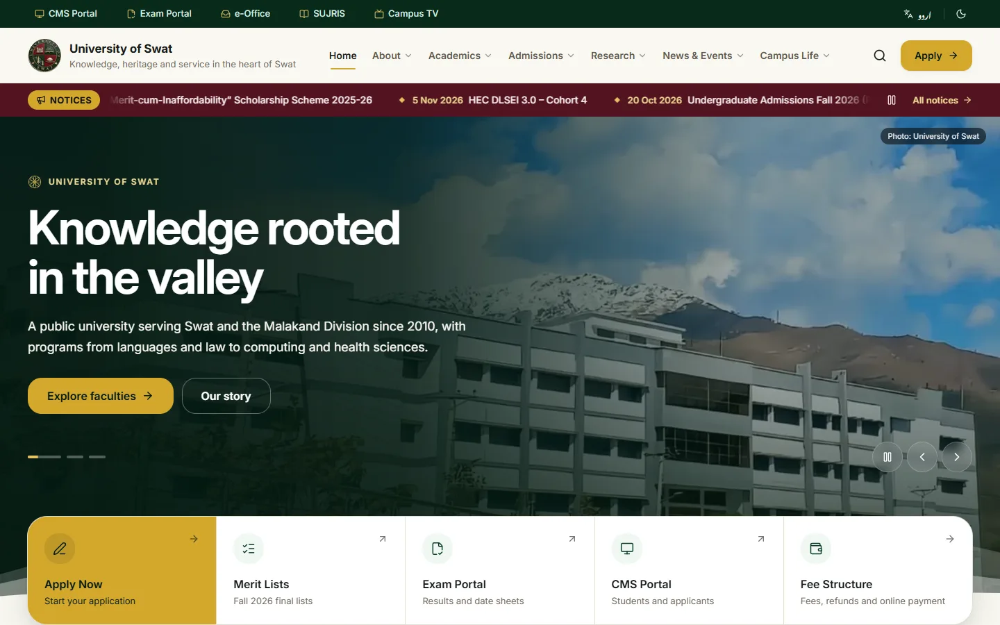

| | |
|---|---|
| **Built with** | Next.js 16 · React 19 · TypeScript (strict) · Tailwind CSS 4 · Strapi 5 · PostgreSQL 17 · Node.js 22 · Docker · Nginx · Cloudflare · GitHub Actions |
| **Content** | 28 departments, 78 programs, 23 offices, 26 news posts, 10 tenders, 10 jobs, 67 downloads, all from Strapi and checked against uswat.edu.pk |
| **Quality** | Lighthouse Accessibility, Best Practices and SEO 100 on every page tested · no axe (WCAG 2.2 AA) violations on 26 pages in both languages and themes |
| **CI** | Lint, typecheck and build of both apps, three Docker images and `nginx -t` on every push ([workflow](.github/workflows/ci.yml)) |

**Contents:** [Old site vs new site](#old-site-vs-new-site) · [Screenshots](#screenshots) · [Features](#features) ·
[The 11 required technologies](#the-11-required-technologies) · [Architecture](#architecture) ·
[Lighthouse](#lighthouse-results) · [Quick start](#quick-start) · [Publishing news](#how-staff-publish-news-in-strapi) ·
[Content policy](#content-policy) · [How this was built](#how-this-was-built) · [More documents](#more-documents)

---

## Old site vs new site

The current website has served the university well and holds a lot of valuable information. This entry keeps
all of that content and its structure, and focuses on how it is presented, found and maintained.

| Area | Current site | This entry |
|---|---|---|
| Platform | WordPress with the Elementor page builder | Next.js front end with Strapi as a headless CMS; pages are prerendered and served from cache |
| Homepage figures | Campus, program, faculty and student counters display 0 | Counters are counted live from the database (`GET /api/stats`), so they always match the content |
| Images | Photos uploaded as they arrive from phones, in varying sizes | Every image goes through `next/image` (AVIF/WebP, responsive sizes) in fixed ratios, with a credit linked to its source |
| News thumbnails | Most items share the university logo as thumbnail | Real cover photos where the original post has one, otherwise artwork per category |
| Navigation | Deep menus (Faculty › faculty › department), repeated in two places | One menu, two levels at most, with a keyboard-accessible mega menu on desktop and a full-screen menu on phones |
| Search | No site-wide search | Ctrl/⌘ + K search across pages, news, departments, programs, people, offices, tenders, jobs and downloads, in both languages |
| Languages and themes | English only, light only | English and Urdu (right-to-left, Noto Nastaliq Urdu), light and dark mode |
| Admissions | Spread across several pages | One admissions hub: program finder, advertised eligibility and dates, how to apply, fees, merit lists, FAQs; an **Apply** button on every page |
| Portals | Some links (Exam, CMS) use plain `http://` | Every external link is HTTPS |
| Footer | Notes that the site is best viewed in Google Chrome | Works in every modern browser and without JavaScript for reading |
| Figures in About | Some enrolment figures date from 2017 | Text rewritten from current official pages; anything unpublished is left out rather than guessed |
| Menu labels | A few typos (for example "Students Loan Shemes") | Labels proofread in both languages |
| News, tenders, jobs | Long lists with no filters or pages | Category and open/closed filters, numbered pages, detail pages with documents and share buttons |

## Screenshots

All screenshots are of the production build with the seeded content (November 2026). The full set (8 pages ×
desktop/mobile × English/Urdu × light/dark) is in [`docs/screenshots`](docs/screenshots).

| Desktop, English, light | Desktop, Urdu, dark |
|---|---|
|  | 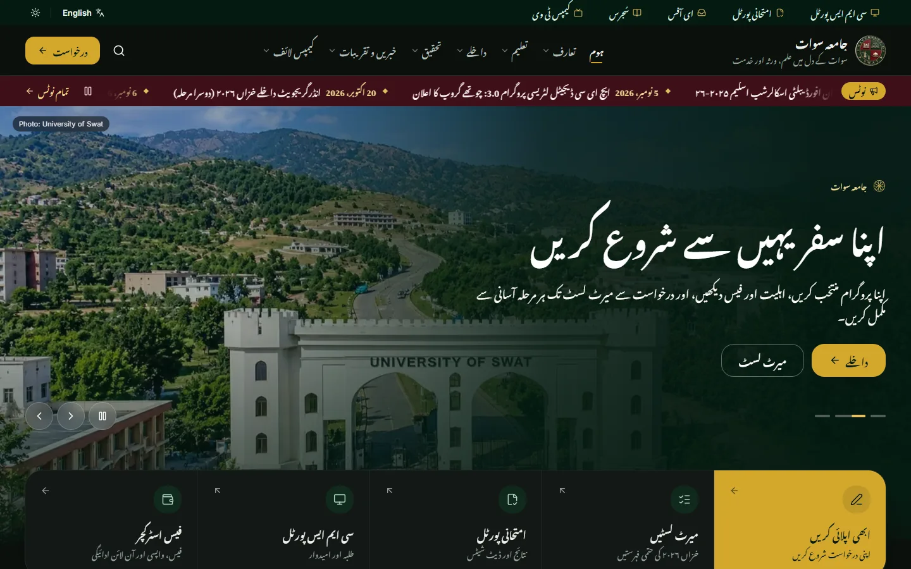 |
| 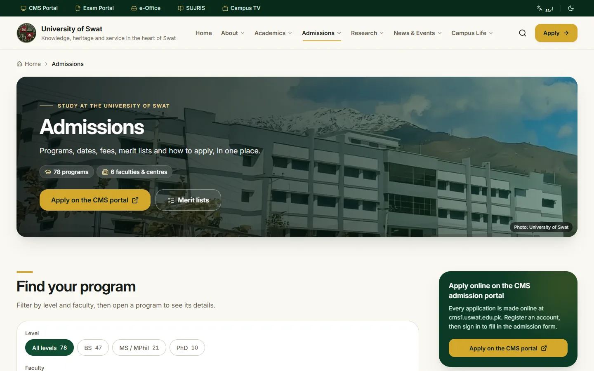 | 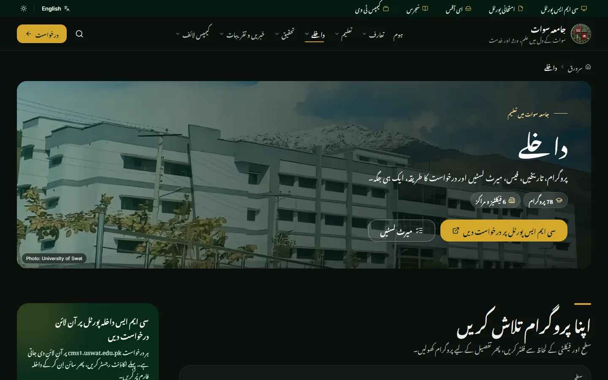 |
| 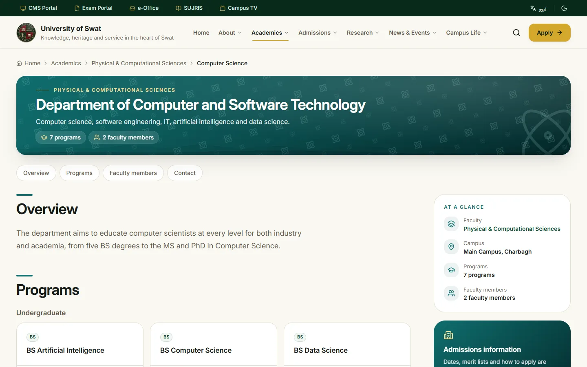 | 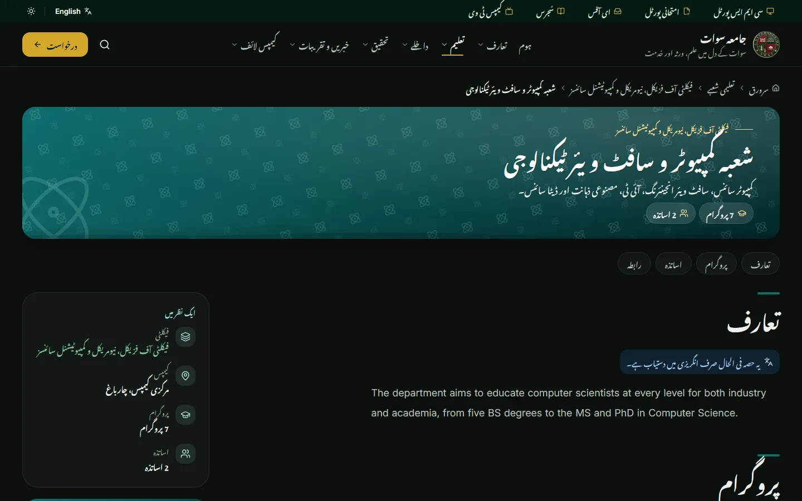 |
| 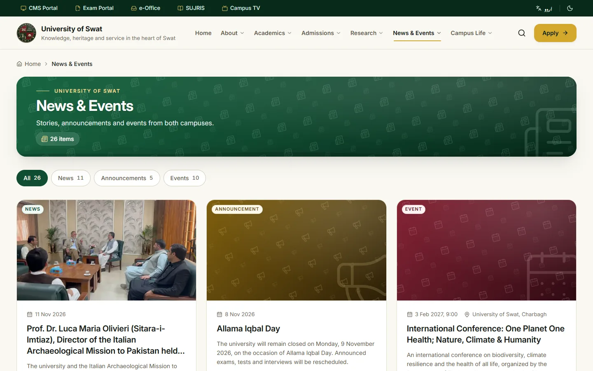 | 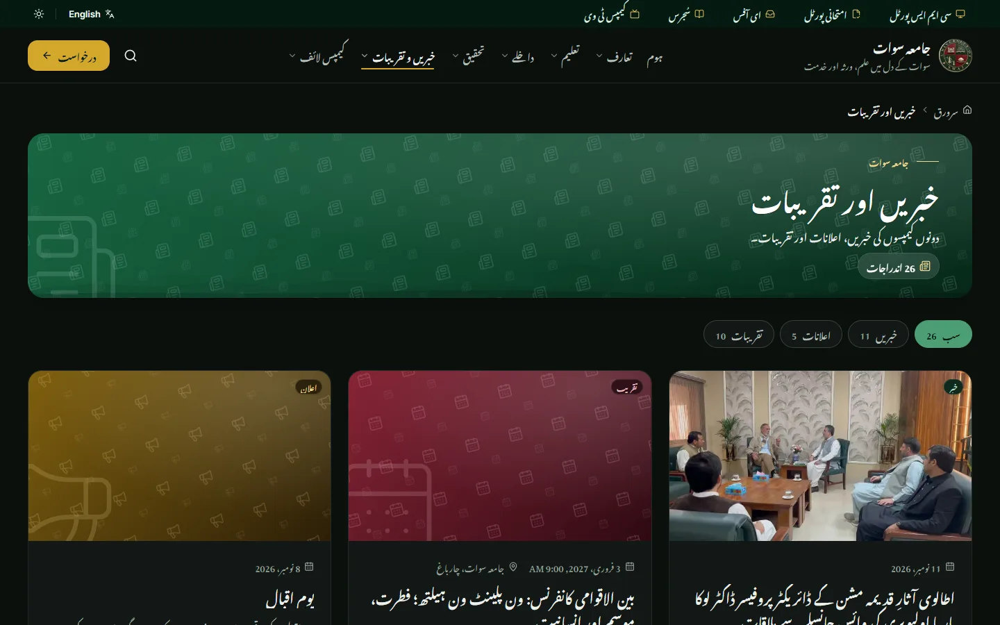 |

| Phone, English, light | Phone, English, dark | Phone, Urdu, light | Phone, Urdu, dark |
|---|---|---|---|
| 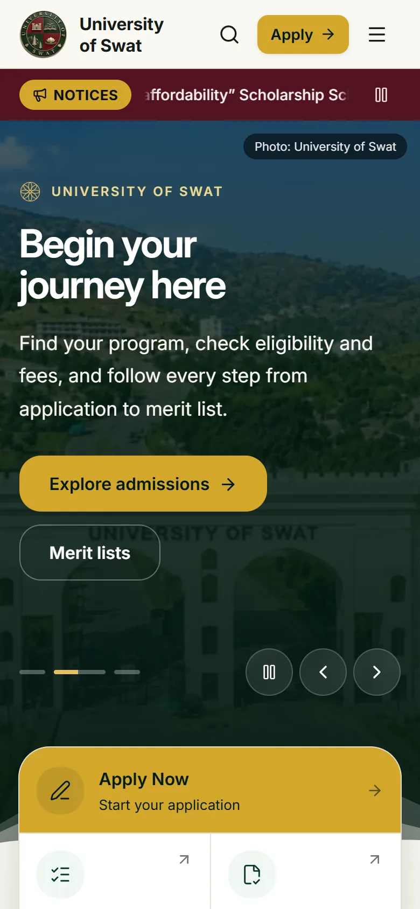 | 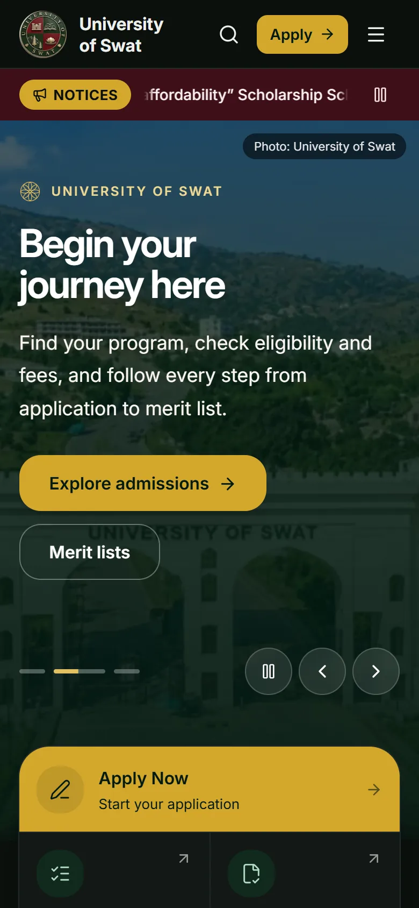 | 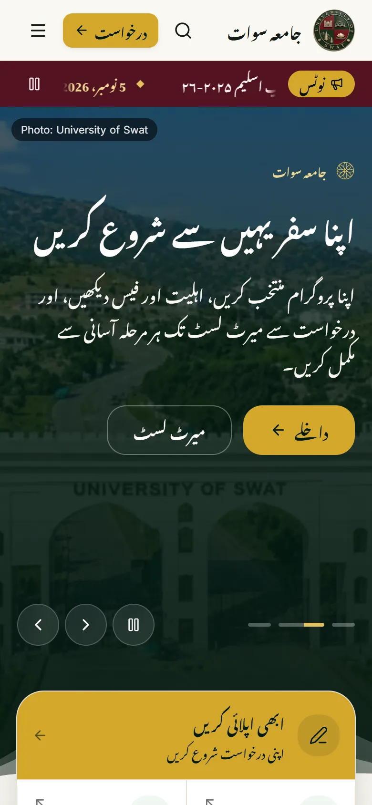 | 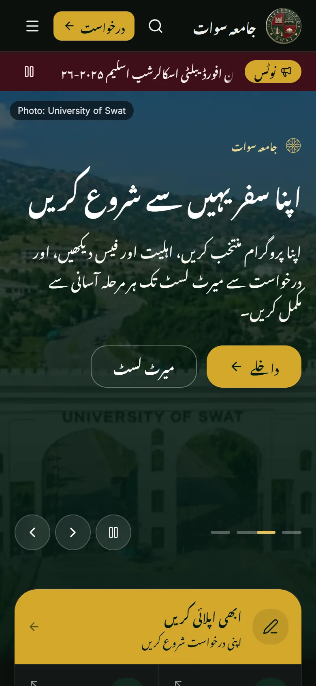 |
| 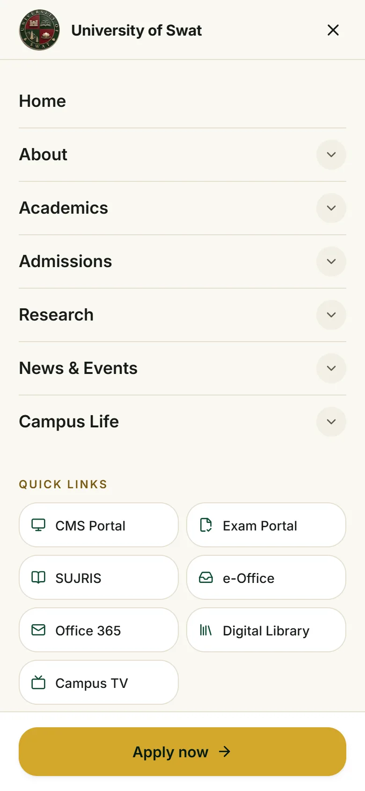 | 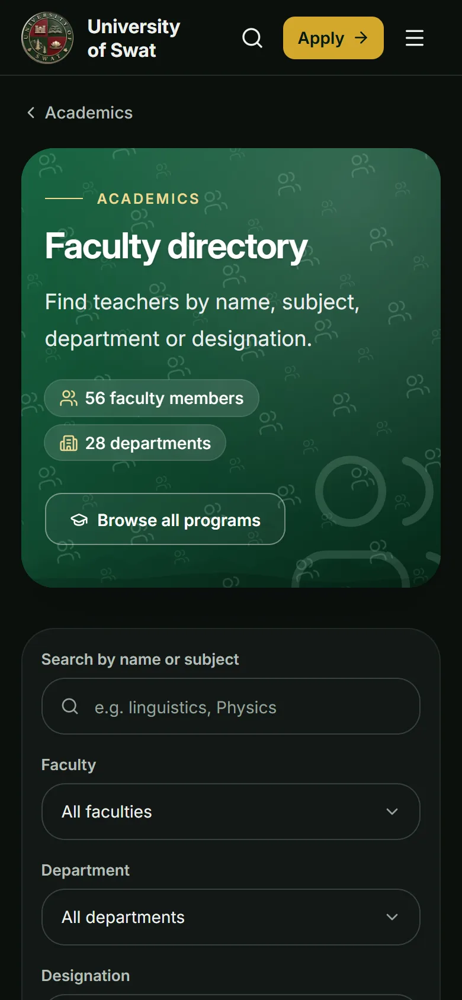 | 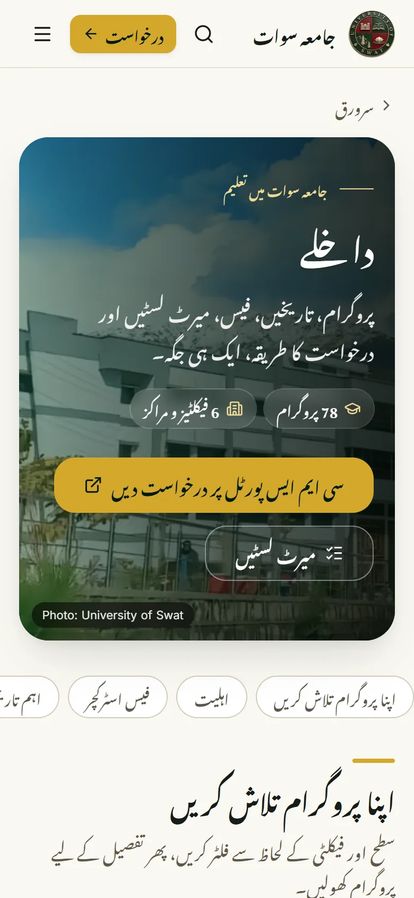 | 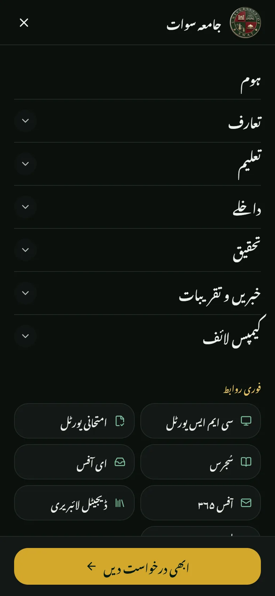 |

| Global search (Ctrl/⌘ + K) | Search in Urdu | Mega menu |
|---|---|---|
| 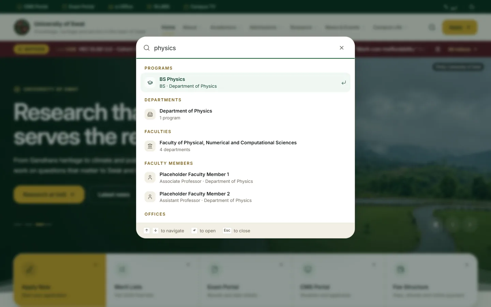 | 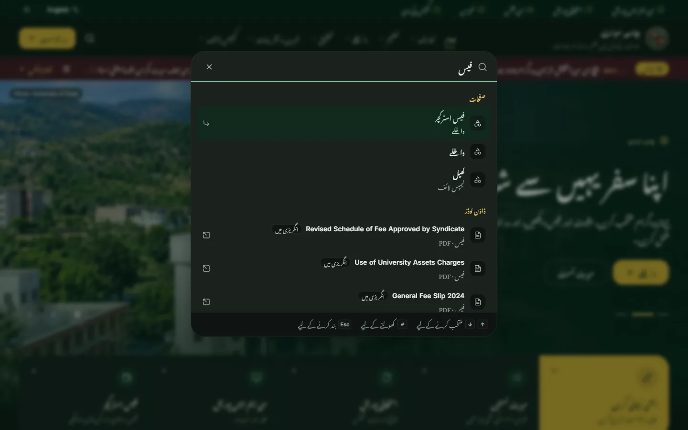 | 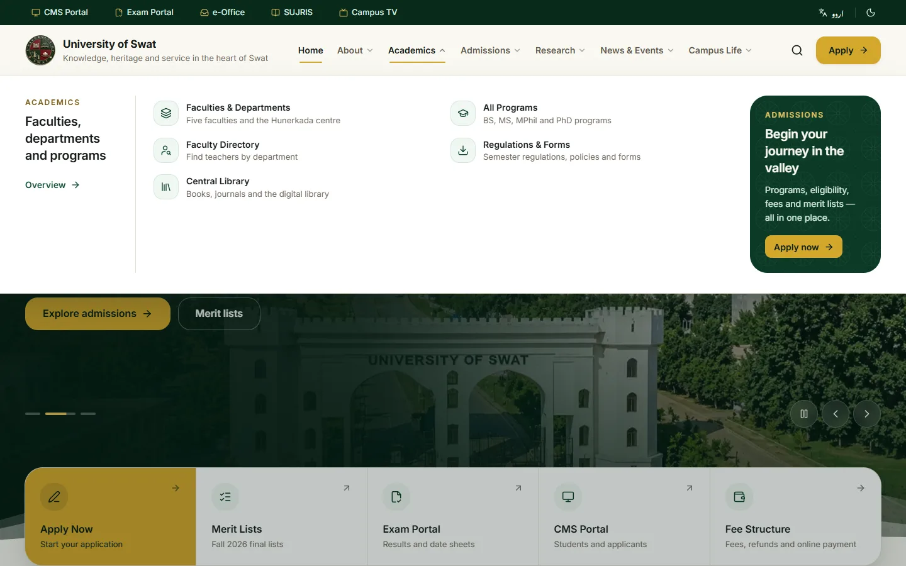 |

The whole homepage, top to bottom: [home-desktop-en-light-full.webp](docs/screenshots/home-desktop-en-light-full.webp).

## Features

**For visitors**
- **Homepage**: hero slider, quick actions (Apply, Merit lists, Exam portal, CMS portal, Fee structure), live
  counters, latest news with real photos, a notices ticker, upcoming events, the Vice Chancellor's message
  (his own published words), faculties, campuses and partners. All of it comes from Strapi.
- **Academics**: faculty › department › program pages. Each department has an overview, programs by level,
  faculty members (head first), contact and an "At a glance" panel. A program finder filters by faculty and level.
- **Faculty directory**: search and filter by faculty, department and designation; filters live in the URL,
  so a filtered view can be shared.
- **Admissions hub**: program finder, advertised eligibility and important dates (open/closed worked out on
  Pakistan time), how to apply, fee structure, merit lists, scholarships and FAQs.
- **News, announcements and events**: one content type with categories, numbered pages, detail pages,
  posters and documents, share buttons and related posts.
- **Tenders and jobs**: open/closed status that closes itself when the deadline passes, reference numbers and
  the official PDF attachments.
- **Downloads**: searchable regulations, forms and reports, filtered by category.
- **About, Administration, Research, Campus Life**: history and milestones, vision and mission, principal
  officers, 23 offices and directorates (head, contact, responsibilities, staff), ORIC/QEC/DASR, the SUJRIS
  journal, funded research projects, library, sports, hostels, societies and Hunerkada.
- **Contact**: a map that loads only when asked, a searchable phone directory with tap-to-call, and a contact
  form saved in Strapi (spam protection: honeypot, signed form token, rate limit, shared secret).
- **Global search** with Ctrl/⌘ + K or `/`, and a `/search` page that works without JavaScript.
- **English and Urdu** with proper right-to-left layout and the Nastaliq script; an English fallback per field,
  clearly marked, when a translation is missing.
- **Dark mode** that follows the device until the visitor chooses, with no flash on load.
- **Accessibility (WCAG 2.2 AA)**: skip link, visible focus, full keyboard use of menus, search, tabs and
  carousels (mirrored in Urdu), contrast checked in both themes, alt text, reduced-motion support.
- **SEO**: titles, descriptions, canonical and `hreflang` on every page, Open Graph and generated social cards,
  `sitemap.xml`, `robots.txt`, and schema.org data (`CollegeOrUniversity`, `BreadcrumbList`, `NewsArticle`,
  `Event`, `JobPosting`, `FAQPage`, `EducationalOccupationalProgram`).
- Custom 404 and error pages in both languages.

**For staff**
- Everything on the site is edited in Strapi; nothing is hardcoded in the front end.
- A change is live on the next page view: Strapi notifies the website, which refreshes only the affected pages.
- Three roles: **Super Admin**, **Media Cell Editor** (news, events, hero slides) and **Department Editor**
  (only their own department, its programs, faculty members, downloads and research projects; enforced on
  the server, not only hidden in the admin panel).
- Draft and publish, Urdu translations side by side, a Media Library with captions used as photo credits.
- A seed script fills an empty database with the university's real structure and content.

## The 11 required technologies

| # | Technology | Where it is used |
|---|---|---|
| 1 | **Next.js 16** (App Router) | [`frontend/src/app`](frontend/src/app): every page, prerendering with Cache Components, `next/image`, the search index (`api/search`), the revalidation webhook (`api/revalidate`), social cards (`api/og`), `sitemap.xml`, `robots.txt` |
| 2 | **React 19** | Server Components for all pages; small client components only for interactive parts (search dialog, menus, hero slider, filters, theme switch) in [`frontend/src/components`](frontend/src/components) |
| 3 | **TypeScript** (strict, no `any`) | Both apps: [`frontend/tsconfig.json`](frontend/tsconfig.json), [`cms/tsconfig.json`](cms/tsconfig.json); typed Strapi client in [`frontend/src/lib/strapi`](frontend/src/lib/strapi); `npm run typecheck` in CI |
| 4 | **Tailwind CSS 4** | Design tokens (green, maroon, gold, dark mode, type scale) in [`frontend/src/app/globals.css`](frontend/src/app/globals.css); every component |
| 5 | **Strapi 5** (headless CMS) | [`cms/`](cms): content types in `cms/src/api`, editor roles and department guard in `cms/src/bootstrap`, seed script in `cms/scripts/seed` |
| 6 | **PostgreSQL 17** | Strapi's database ([`cms/config/database.ts`](cms/config/database.ts)); the `postgres` service in [`docker-compose.yml`](docker-compose.yml), on an internal network only Strapi can reach |
| 7 | **Node.js 22 LTS** | Runtime for both apps ([`.nvmrc`](.nvmrc), `engines` in each `package.json`); Docker images on `node:22-alpine` |
| 8 | **Docker** + docker-compose | [`frontend/Dockerfile`](frontend/Dockerfile), [`cms/Dockerfile`](cms/Dockerfile), [`nginx/Dockerfile`](nginx/Dockerfile); [`docker-compose.yml`](docker-compose.yml) runs nginx, frontend, cms and postgres |
| 9 | **Nginx** | [`nginx/nginx.conf`](nginx/nginx.conf): TLS, HTTP/2, gzip + Brotli, image and media caching, security headers (CSP, HSTS), rate limits, real visitor IP from Cloudflare |
| 10 | **Cloudflare** | DNS, CDN, edge SSL in Full (strict) mode with an Origin Certificate, cache rules; set-up steps in [`DEPLOY.md`](DEPLOY.md#3-cloudflare) |
| 11 | **GitHub** + Actions | This repository; [`.github/workflows/ci.yml`](.github/workflows/ci.yml) lints, typechecks and builds both apps, builds the three Docker images and tests the Nginx config on every push |

Also used: next-intl (English/Urdu routing and messages), lucide-react (icons), sharp (seed image processing).

## Architecture

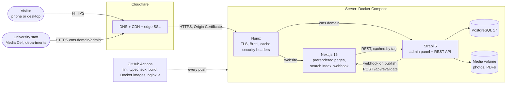

**How a page is served.** Next.js renders each page once from Strapi data and keeps it in its cache, tagged
with the content it uses (`posts`, `academics`, `admissions`, …). Visitors get that cached HTML straight away;
Strapi is not asked again until something changes.

**How a change goes live.** When an editor saves or publishes, Strapi calls the website's `POST
/api/revalidate` (on the internal Docker network, with a secret). The website expires only the matching tags,
so the next visitor sees the new content, and the sitemap and search index refresh with it. If Strapi is ever
down, the website keeps serving the last good pages.

More detail: [`docs/JUDGES_QA.md`](docs/JUDGES_QA.md) (plain-language walkthrough) and [`DEPLOY.md`](DEPLOY.md).

## Lighthouse results

Measured with Lighthouse 12.8.2 on the production build, on the development laptop (Windows, 8 GB RAM) with
Strapi on the same machine; median of 3 runs.

| Page | Accessibility | Best Practices | SEO | Performance, desktop | Performance, mobile |
|---|---|---|---|---|---|
| Home | **100** | **100** | **100** | 81 | 45–61 |
| Department (Computer & Software Technology) | **100** | **100** | **100** | 96 | 59 |
| Program (BS Artificial Intelligence) | **100** | **100** | **100** | 97 | 65 |
| Admissions | **100** | **100** | **100** | 95 | 48–69 |
| News article | **100** | **100** | **100** | 96 | 62 |

**About the performance numbers, honestly.** Accessibility, Best Practices and SEO are 100 on every page tested.
Performance does not yet reach the 95 target on mobile in these lab runs. Lighthouse's mobile test slows the
CPU four times, and on this laptop (often under 1 GB free memory, CPU speed varying about five-fold between runs)
most of the remaining cost is React and the Next.js runtime starting up (Total Blocking Time 0.7–2.5 s).
Desktop scores and the single mobile figures are from Phase 11; the mobile ranges for Home and Admissions are
from Phase 12. What was
done about it (Phase 12): pages are Server Components first, framer-motion was removed, menus and search load
only on first use, and the start-up JavaScript of the homepage went from 253 KB to 214 KB gzipped. With
real network throttling, mobile Largest Contentful Paint is 2.1–2.8 s on the pages above. The two ranges
show the default 4× CPU slowdown and one calibrated to this laptop. The fair measurement is
[PageSpeed Insights](https://pagespeed.web.dev/) on the real server behind Cloudflare, which will be added here
after deployment. Full method and before/after tables: [CHANGELOG.md, Phases 11 and 12](CHANGELOG.md#phase-11--quality-pass).

## Quick start

### Option A: Docker Compose (the whole stack)

Needs Docker Engine with the Compose plugin.

```bash
git clone https://github.com/Habibakhan77/University-of-swat.git && cd University-of-swat
cp .env.example .env            # fill in the secrets; the file explains each one and how to generate them
docker compose up -d --build    # nginx, frontend, cms, postgres
docker compose --profile seed run --rm cms-seed   # once: fill Strapi with University of Swat content
```

On a laptop, `docker-compose.override.yml` is merged automatically: the website is on
<http://localhost:8080>, the Strapi admin on <http://cms.localhost:8081/admin> (create the first administrator
there), PostgreSQL on port 5433, and there is no Nginx. On a server, follow [DEPLOY.md](DEPLOY.md) (Ubuntu,
Cloudflare DNS and SSL, backups, updates).

### Option B: local development (no Docker)

Needs Node.js 22 LTS and PostgreSQL 17 with a database `uswat` owned by a role `uswat`.

```bash
# 1. CMS
cd cms
cp .env.example .env            # set DATABASE_PASSWORD and the secrets
npm install
npm run dev                     # http://localhost:1337/admin — create the first administrator
npm run seed                    # in a second terminal: fill the empty database

# 2. Website
cd ../frontend
cp .env.example .env.local      # STRAPI_URL=http://localhost:1337 and the same REVALIDATE_SECRET as the CMS
npm install
npm run dev                     # http://localhost:3000  (Urdu: http://localhost:3000/ur)
```

Useful scripts: `npm run lint`, `npm run typecheck` and `npm run build` in each app; `npm run seed -- --reset`
in `cms/` wipes website content and reseeds it (admin users and contact messages are kept). See
[`cms/scripts/seed/README.md`](cms/scripts/seed/README.md) for what the seed creates and what staff still need to
replace.

## How staff publish news in Strapi

Staff never touch code. A Media Cell editor publishes a news story in about two minutes:

1. Sign in at `https://cms.<domain>/admin` with the account the Super Admin created.
2. Open **Content Manager › Post** and click **Create new entry**.

   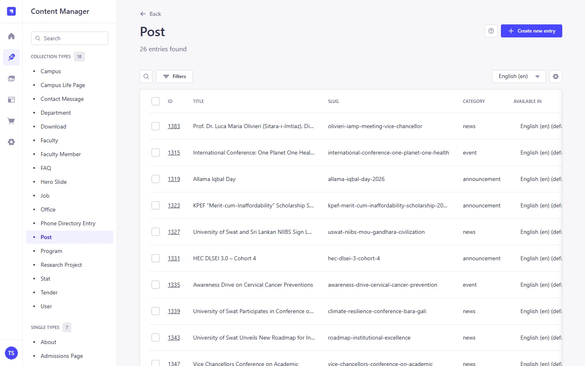

3. Fill in **title** (the **slug**, the web address, is made from it), choose a **category** (news,
   announcement or event), write a short **excerpt** and the **content**. Add a **coverImage** from the Media
   Library; its caption becomes the photo credit. For an event, add **eventStart**, **eventEnd** and
   **eventLocation**; to show it in the homepage notices ticker, switch on **showInTicker**.

   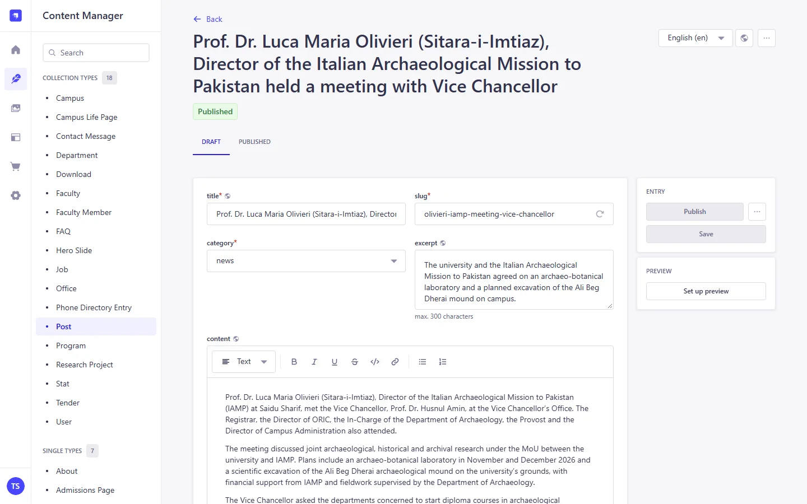

4. Optional: switch the locale at the top to **Urdu** and add the Urdu title and excerpt. Fields left empty
   fall back to English on the Urdu site, clearly marked.
5. Click **Publish**. The homepage, the News page, the story's own page, the search index and the sitemap
   update for the next visitor. Nothing else needs to be done.

Department editors work the same way on their own department, programs, faculty members and downloads;
they can't see or change other departments. Setting up editors: [DEPLOY.md › Editors and roles](DEPLOY.md#43-editors-and-roles).

## Content policy

- **Only official content.** Department, program, office and contact details, news, tenders, jobs and downloads
  come from uswat.edu.pk (and the university's CMS portal and official Facebook page), checked in November 2026.
  Long texts are rewritten, not copied. Anything that isn't published (fees, shifts, founding years, phone numbers)
  is left out rather than guessed. Each post, tender, job, download and office keeps a link to its source.
- **Official files.** Tender, job and download attachments are the university's own PDFs and forms, stored in
  the Media Library with a link to the original.
- **No invented people.** Faculty members without published profiles are clearly marked placeholders
  (badge, neutral silhouette, notice above the list), never a made-up real-sounding name.
- **No invented quotes.** The Vice Chancellor's message is verbatim from his published message, in the English
  original on both language versions, with a link to the source.
- **Photo credits.** Every photo is the University of Swat's own, from uswat.edu.pk or its official Facebook
  page, shown with a "Photo: University of Swat" credit linked to where it was published. The list is in
  [`cms/scripts/seed/assets/photos/CREDITS.md`](cms/scripts/seed/assets/photos/CREDITS.md). Where no usable photo
  exists, the site draws branded artwork instead of using stock images.
- Social icons are the CC0 Simple Icons paths; fonts are Inter and Noto Nastaliq Urdu (SIL Open Font License).

## How this was built

This entry was designed and built by **Habiba Khan**, with **[Claude Code](https://claude.com/claude-code)**
(Anthropic's AI coding assistant) writing most of the code under Habiba's direction. Being open about this matters:
judges should know what the tool did and what the person did.

**What Habiba decided:**
- The goals, the required stack and the problems to fix, written down in [`CLAUDE.md`](CLAUDE.md) before any code.
- The build plan in 14 phases ([`PROMPTS.md`](PROMPTS.md)), one reviewable step at a time, each ending in a commit.
- The content rules: only official university content, placeholders clearly marked, no invented people or quotes.
- Design direction (crest colours, Swat valley and Gandhara motifs, calm academic look) and every review round.

**What Habiba checked:**
- Each phase in the browser before moving on; the review-fix phases in the [changelog](CHANGELOG.md) (5.3, 6.1–6.5,
  8.1, 9.1) are Habiba's findings, for example the hero copy, sharper campus photos, short hero intros and the
  language switcher.
- Content against the official site. Habiba caught the first version of the Vice Chancellor's message being our own
  text shown as his words, and had it replaced by his verbatim published message with a source link.
- That lint, typecheck and build pass after every feature, and that CI is green on GitHub.

**What Claude Code did:** wrote the code, the seed script and the documentation; researched and transcribed
content from uswat.edu.pk; ran Lighthouse, axe, keyboard and screen-size checks; and recorded each step in
[`CHANGELOG.md`](CHANGELOG.md). Its working rules (strict TypeScript, ask before installing anything,
small commits) are in `CLAUDE.md`.

## More documents

| Document | For |
|---|---|
| [`docs/SUBMISSION.md`](docs/SUBMISSION.md) | One-page summary for the Chairman, DCST |
| [`docs/JUDGES_QA.md`](docs/JUDGES_QA.md) | How the main parts work, in plain language, and likely judge questions |
| [`docs/DEMO_SCRIPT.md`](docs/DEMO_SCRIPT.md) | 2–3 minute demo video script with timings |
| [`docs/DEMO_SCRIPT_UR.md`](docs/DEMO_SCRIPT_UR.md) | The same demo in Urdu: narration in Urdu script and Roman Urdu, with bilingual captions |
| [`DEPLOY.md`](DEPLOY.md) | Server, Cloudflare, backups and updates |
| [`CHANGELOG.md`](CHANGELOG.md) | What was built in each phase, with test results |
| [`cms/scripts/seed/README.md`](cms/scripts/seed/README.md) | Seed content and the checklist for university staff |

## Repository layout

```
frontend/                    Next.js app (pages in src/app/[locale], components, Strapi client, search)
cms/                         Strapi app (content types, roles, webhook, seed script)
nginx/                       nginx.conf, snippets and Dockerfile (Brotli)
docker-compose.yml           Production stack: nginx, frontend, cms, postgres
docker-compose.override.yml  Local Docker stack (merged automatically on a laptop)
.env.example                 Every docker-compose setting, documented
.github/workflows/ci.yml     CI
docs/                        Screenshots, demo script, judges' guide, submission summary
```
